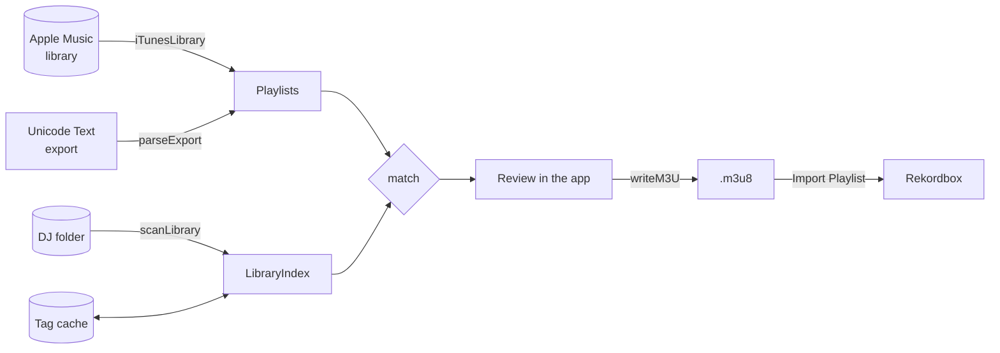

# Architecture

CrateMate is a Swift package with two targets:

- **`CrateMateCore`**, a library with all the logic and no UI. Everything that can be tested lives here.
- **`CrateMate`**, the SwiftUI app. It's a thin layer over the core: one observable model and the views.



## Core (`Sources/CrateMateCore`)

| File | Responsibility |
|---|---|
| `AppleMusic.swift` | Reads the user's playlists through `iTunesLibrary`. |
| `ExportParser.swift` | Reads Apple Music's "Unicode Text" playlist export. |
| `Library.swift` | Scans the DJ folder, reads tags and keeps the tag cache. |
| `Normalize.swift` | Normalises text, splits titles and guesses tags from filenames. |
| `Matcher.swift` | Scores songs against library files (`LibraryIndex`). |
| `M3U.swift` | Writes the `.m3u8`. |

### Reading Apple Music

`loadAppleMusicPlaylists()` opens `ITLibrary` and keeps only the user's own playlists. It drops the master library, Apple's built-in playlists (Music, Movies, …), folders, and anything with no songs in it. Only songs are kept from each playlist; videos and podcasts are dropped. The name of the folder a playlist is in is kept so the sidebar can group by it.

The playlists contain metadata only (title, artist, album and length), which is why cloud-only libraries work. `iTunesLibrary` needs the Media & Apple Music permission, and it only works when the process was launched as an app bundle through LaunchServices.

### Reading a text export

`parseExport(_:)` is the fallback for when Apple Music can't be read. It also makes test fixtures easy. Apple Music writes the export as UTF-16LE with a BOM, tab-separated, with CR line endings. The parser also accepts UTF-8 and UTF-16BE, and either seconds or `m:ss` in the time column. It finds columns by header name. It rejects M3U files with a message explaining how to export the right format, since M3U is the export users try first.

### Scanning the DJ folder

`scanLibrary(_:rescan:progress:)`:

1. Lists every audio file under the folder, skipping hidden files and package contents. Each file gets a cache key made of its size and modification time.
2. Reads tags for files whose key isn't in the cache, with 16 reads in flight at once. `readTags` tries Core Audio's `kAudioFilePropertyInfoDictionary` first, which is fast and handles MP3, AIFF, WAV, FLAC and M4A. It falls back to AVFoundation for anything Core Audio left blank.
3. Drops cache entries for files under this folder that no longer exist, then saves the cache to `~/Library/Application Support/CrateMate/library-cache.json`.
4. For untagged files, guesses the artist and title from the filename (`fromFilename`, e.g. `01 - Artist - Title.wav`).
5. Returns a `LibraryIndex`.

Files are opened read-only. Nothing in the core writes inside the DJ folder.

### Normalising text

Matching works on normalised text (`norm`): NFKD, combining marks stripped, lowercased, `&` turned into "and", and every run of characters that aren't letters or digits turned into one space. So "Café del Mar" and "Cafe del Mar" match, and Greek, Cyrillic or Japanese titles keep their letters.

`splitTitle` takes a title apart into three pieces:

- **core**: the title with the version and featured-artist parts removed;
- **version tokens**: words from bracketed parts like `(Joe Remix)` or `[Extended Mix]`, and from a dash suffix like `- Radio Edit`. Neutral words such as "original", "mix" and "version" are dropped, so "Track (Original Mix)" and "Track" have the same version;
- **feats**: featured artists, whether from `(feat. X)` in brackets or a trailing `ft. X`.

### Scoring

`LibraryIndex` prepares every file once: split title, token sets and artist tokens. It also builds an inverted index from core-title words to files. `match(_:)` scores only the files that share at least one core-title word with the song, and falls back to every file if none do.

Each candidate gets a score from 0 to 1:

```
score = 0.5 × title + 0.3 × artist + 0.2 × version + length adjustment   (clamped to 0…1)
```

| Part | How it's calculated |
|---|---|
| title | The highest of: exact core match (1), Dice coefficient of the core words, and Levenshtein similarity of the core strings. Levenshtein is what catches typos like "Stings of Life". |
| artist | The share of the smaller artist-token set found in the larger one. The tokens include featured artists, and joiners like "feat", "and", "x", "vs" are removed. If either side has no artist, it scores 0.5. |
| version | 1 if neither has version tokens. If only one does: 0.6 if those words just describe a cut ("extended", "radio", "edit", "club", "remaster", …), otherwise 0.2. If both do: Dice of the two sets. |
| length | If both lengths are known: +0.10 within 3 s, +0.03 within 10 s, −0.15 more than 30 s apart. |

The length adjustment is what separates an Extended Mix from an Original Mix when Apple Music's title doesn't say which it is.

### Classifying the result

| Status | Rule |
|---|---|
| `ok` | The best score is ≥ 0.85 (`matchThreshold`), with no close runner-up. |
| `check` | The best score is ≥ 0.70 (`probableThreshold`), or it would be `ok` but a *different recording* scored within 0.03 of it (and at least 0.70). |
| `missing` | Anything else. Nothing is picked by default. |

Two files count as **the same recording** if their core titles and version tokens are identical and their lengths are within a second of each other, or either length is unknown. Copies of the best match are reported as `dupes` rather than as runners-up, so owning a track twice doesn't stop it being a confident match. The UI warns about the duplicates instead.

`candidates` lists up to 6 files scoring at least 0.35, best first. They fill the row's picker.

### Search

`search(_:limit:)` backs the 🔍 popover. It splits the query into words and keeps files where any query word is a prefix of a word in the artist, title or filename. Results are ranked by the share of query words that hit, then by title.

### Writing the playlist

`m3uText` writes extended M3U in UTF-8 with LF line endings:

```
#EXTM3U
#EXTINF:390,Mr Fingers - Track A (Original Mix)
/Users/me/Music/DJ/House/Track A (Original Mix).mp3
```

The duration is in whole seconds, or `-1` if unknown. `writeM3U` names the file after the playlist, with `/` and `:` replaced by `-`. The path is absolute, because Rekordbox links an entry to an existing collection track by comparing paths.

## App (`Sources/CrateMate`)

| Type | Role |
|---|---|
| `AppModel` | The single `@MainActor @Observable` state object: settings, playlists, scan state, the `LibraryIndex`, reviews per playlist, and export. |
| `PlaylistReview` | The match results for one playlist. Built the first time the playlist is selected after a scan. |
| `RowReview` | One song. `pick` is the chosen file path, or `nil` to skip it. `touched` records whether the user changed it. |
| `ContentView` and others | Sidebar (playlists grouped by folder, plus the DJ and output folder footer), detail (scan progress or the review list), toolbar (filter and Export). |

How the app behaves:

- Apple Music reading, scanning and matching run off the main actor with `Task.detached` or `async` core functions. Results are assigned back on the main actor.
- A rescan clears `reviews`, because the picks were made against the old index.
- Settings live in `UserDefaults`: `library` (the DJ folder) and `output` (the export folder, `~/Music/CrateMate` by default). If either is unset, `AppModel` falls back to the value saved under the app's old bundle identifier, `com.bobbyf.am2rb`, so settings carry over from before the rename.
- **UI state lives on the model objects**, not in `@State`. Examples are `RowReview.searching` and `AppModel.playlistFilter`. See [CODE_STYLE.md](CODE_STYLE.md#swiftui) for why.

## Building the app bundle

The project is a plain SwiftPM package. It has no Xcode project, so `scripts/build-app.sh` makes the `.app` itself:

1. It builds the release binary with `swift build -c release`.
2. It lays out `build/CrateMate.app/Contents/{MacOS,Resources,Info.plist}`.
3. It restamps the binary's SDK version with `vtool`. SwiftPM records the deployment target (14.0) as the SDK version, which makes macOS run the app in compatibility mode, with the old window chrome and a title bar that doesn't follow the sidebar divider.
4. It copies `Resources/AppIcon.icns` into the bundle and points `CFBundleIconFile` at it. The icon is drawn in code by `scripts/make-icon.swift`; run `scripts/make-icon.sh` after changing it, and commit the `.icns` and `docs/assets/icon.png` it writes.
5. It ad-hoc signs the bundle (`codesign --sign -`). That way TCC can remember the Apple Music permission between launches, and nobody needs a paid developer account.
